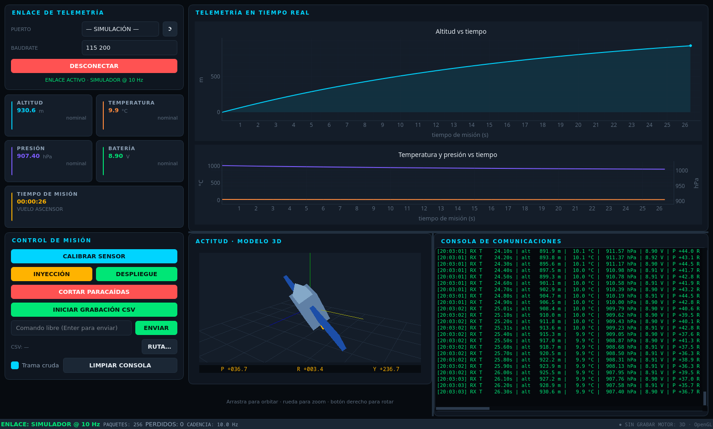

# CanSat · Estación Terrestre (Ground Station)

Aplicación de escritorio en Python para recibir, visualizar y controlar la
telemetría de un CanSat: **PyQt5 + PyQtGraph + OpenGL (pyqtgraph.opengl)**
con tema oscuro de estilo aerospacial.



## Dependencias

```bash
pip install -r requirements.txt
# equivalente:
pip install PyQt5 pyqtgraph PyOpenGL numpy pyserial
```

Linux (Debian/Ubuntu) necesita las librerías de sistema para OpenGL:

```bash
sudo apt install libgl1 libglu1-mesa x11-utils
```

Si PyOpenGL no está disponible la aplicación **arranca igualmente** y sustituye
la vista 3D por un horizonte artificial 2D (motivo del fallback en la barra de
estado y bajo el indicador de actitud).

## Ejecución

```bash
python3 main.py                    # normal
python3 main.py --sim              # arranca con el simulador de vuelo
python3 main.py --port /dev/ttyUSB0 --baud 115200
```

Sin argumentos, el desplegable ofrece:

* **— SIMULACIÓN —** – telemetría sintética (ascenso → apogeo → despliegue →
  descenso con paracaídas) a 10 Hz, para probar la estación sin|Arduino.
* Los puertos COM/TTY detectados, con su descripción.

Atajos: `Ctrl+O` conectar · `Ctrl+D` desconectar · `Ctrl+R` grabación · `Ctrl+L` limpiar consola.

## Protocolo de telemetría

Trama CSV terminada en `\r` o `\n`:

```
T,t,alt,temp,pres,vol,pitch,roll,yaw,state,sat,chute,packet
T,125.40,1042.6,22.8,891.4,8.61,3.1,-2.4,179.8,1,1,0,1254
```

| Campo | Unidad | Descripción |
|-------|--------|-------------|
| `t` | s | Tiempo de misión |
| `alt` | m | Altitud |
| `temp` | °C | Temperatura |
| `pres` | hPa | Presión atmosférica |
| `vol` | V | Tensión de batería |
| `pitch`, `roll`, `yaw` | ° | Actitud |
| `state` | — | 0 pre-lanzamiento · 1 vuelo · 2 descenso · 3 aterrizaje |
| `sat` | — | Estado del conjunto de parenthood |
| `chute` | — | Estado del paracaídas |
| `packet` | — | Contador de paquetes (permite detectar pérdidas) |

También se aceptan tramas de estado: `E,<texto>` (eventos) y `OK/CMD/ACK/...`
(confirmaciones del|Arduino). Las tramas corruptas se registran en consola y
cuentan como paquete perdido, sin detener el flujo.

### Comandos hacia el|Arduino

| Botón / constante | Trama enviada |
|-------------------|---------------|
| Calibrar sensor | `C,CAL,1` |
| Inyección | `C,INJ,1` |
| Despliegue | `C,DEP,DEPLOY` |
| Cortar paracaídas | `C,CHUTE,CUT` |
| Reset | `C,SYS,RESET` |
| Campo libre | el texto que se escriba (Enter para enviar) |

Están definidos en `gs/protocol.py` (`CMD_*`) para poder adaptarlos al firmware.

## Funcionalidades

1. **Panel de conexión** — selector de puerto COM/TTY, baudrate (9600…921600),
   botón Conectar/Desconectar y estado del enlace.
2. **Indicadores digitales** — Altitud (m), Temperatura (°C), Presión (hPa),
   Batería (V, con alerta por debajo de 6,8 V), Tiempo de misión `ST` (HH:MM:SS)
   y estado de la misión.
3. **Gráficas en tiempo real** — Altitud vs tiempo (con relleno y marcador del
   último punto) y Temperatura/Presión vs tiempo con **eje derecho secundario**
   para la presión. Buffers circulares (1500 muestras) y redibujado limitado a
   4 Hz para no saturar la CPU.
4. **Modelo 3D / actitud** — satélite (fuselaje, morro, paneles solares, antena)
   construido con mallas propias sobre `GLViewWidget`, rotado según
   pitch/roll/yaw. Cámara interactiva (arrastrar = orbitar, Ctrl+arrastrar =
   desplazar, rueda = zoom). Respaldo 2D si no hay OpenGL.
5. **Control y logs** — botones de calibración, inyección, despliegue, corte de
   paracaídas, grabación CSV y consola con marca de tiempo y color por nivel
   (TX azul, RX verde, avisos ámbar, errores rojo).
6. **Hilosecondaria (QThread)** — `SerialWorker` lee el puerto, parsea y publica
   la telemetría por señales Qt; la interfaz nunca se bloquea.

Extras: detección de paquetes perdidos y cadencia (Hz) en la barra de estado,
escaneo de puertos en segundo plano, grabación CSV con cabecera, cierre seguro
del puerto y de la grabación al salir.

## Estructura del código

```
cansat/
├── main.py                 # arranque, opciones de línea de comandos, tema global
├── requirements.txt
├── README.md
└── gs/
    ├── __init__.py
    ├── main_window.py      # dashboard: layout, cableado de señales, barra de estado
    ├── theme.py            # paleta dark, hoja de estilos Qt y estilo de pyqtgraph
    ├── protocol.py         # dataclass Telemetry, parseo de tramas, comandos, CSV
    ├── serial_worker.py    # QThread de recepción + PortScanThread + FlightSimulator
    ├── recording.py        # CsvRecorder (inicio/parada en caliente, thread-safe)
    └── widgets/
        ├── __init__.py
        ├── connection.py   # Panel base + ConnectionPanel (puerto/baud/conectar)
        ├── indicator.py    # IndicatorCard y MissionClockCard
        ├── plots.py        # TelemetryPlots (altitud + temperatura/presión)
        ├── attitude.py     # AttitudeIndicator (3D OpenGL / respaldo 2D)
        └── console.py      # LogConsole y ControlPanel
```

Notas de diseño:

* El hilo de recepción nunca toca widgets: emite `telemetry`, `log`, `linked` y
  `stats`, que la ventana consume en el hilo de la interfaz.
* La grabación se escribe desde el hilo de datos (orden garantizado, sin
  bloquear la UI) y se sincroniza con un `lock`.
* Los widgets se registran sin estado global: `SerialWorker` se puede reutilizar
  fuera de esta ventana.

## Formato del CSV grabado

```
mission_time_s,altitude_m,temperature_c,pressure_hpa,voltage_v,pitch_deg,roll_deg,yaw_deg,state,satellite,chute,packet
```